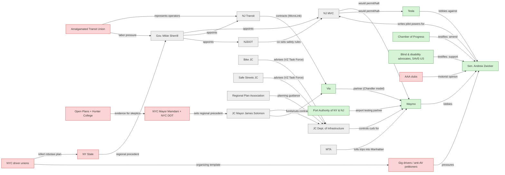

# Jersey City Autonomous Mobility Power Map

_As of 2026-11-09. Who can enable, block, or shape driverless AV service on Jersey City streets?_

Scores: **power** 1-5: ability to enable/block AV ops in JC (5 = can legally allow/stop it) · **interest** 1-5: how actively engaged on AVs in NJ/JC (5 = core business or active lobbying) · **stance** -2..+2 toward driverless AV deployment in JC; 0 = neutral or no public position found

## So what

1. The decision sits with the state, not the city. Nothing driverless runs in JC until S1677/A3968 clears Senate Budget & Appropriations and both floors, and Gov. Sherrill signs it. After that, MVC holds a halt power over every operator.
2. The bill picks winners. Waymo's sensor stack complies (after a human-driver phase). Tesla's camera-only Robotaxi and pedal-less Cybercab do not.
3. The city's levers are the curb and Via. JC's deficit of about $90M already cut Via's hours. The Waymo-Via Chandler model is the cheapest local entry point, and the Mayor, Kaplan and the Council control it.
4. The biggest gap: the City, Bike JC and Safe Streets JC have no public AV position. The reinstated Vision Zero Task Force is where that position will form.
5. Across the Hudson, the regional wind blows against AVs. NYC let Waymo's permits lapse; Hochul pulled her robotaxi plan after the drivers' guild and the transit union fought it. NJ's own coalition (disability advocates, the tech industry) supports S1677, but NY labor is the template for opposition.

## Power map

| Stakeholder | Region | Power | Interest | Stance | Quadrant | Lever |
|---|---|:-:|:-:|---|---|---|
| ★ NJ MVC (Acting Chief Admin. Rosalie Johnson) | NJ/JC | 5 | 3 | Neutral/unknown (0) | Manage closely | Permitting, the halt ('kill switch') power, and pilot rulemaking. |
| Gov. Mikie Sherrill | NJ/JC | 5 | 1 | Neutral/unknown (0) | Keep satisfied | Signature or veto; agency direction. |
| ★ Waymo | NJ/JC | 4 | 5 | Champion (+2) | Manage closely | Shaping S1677/A3968 amendments; Port Authority airport partnership; Via transit integration. |
| Sen. Andrew Zwicker (S1677 prime sponsor) | NJ/JC | 4 | 5 | Supportive (+1) | Manage closely | Bill text: sensor mandate, safety-driver phase, school-zone limits. |
| ★ NJ Transit (CEO Kris Kolluri) | NJ/JC | 4 | 2 | Neutral/unknown (0) | Keep satisfied | First/last-mile partnerships, station access, Turnpike roads (dual role). |
| ★ Via (Via Jersey City) | NJ/JC | 3 | 4 | Supportive (+1) | Manage closely | Existing city contract plus the Waymo integration offers a cheaper per-trip AV option. |
| Port Authority of NY & NJ | NJ/JC | 3 | 3 | Champion (+2) | Manage closely | Airport access is the high-value route for JC robotaxi trips. |
| Amalgamated Transit Union (ATU) | NY/NJ | 3 | 3 | Skeptical (-1) | Manage closely | Labor support in Trenton; operators of the buses AV microtransit would compete with. |
| ★ JC Dept. of Infrastructure (Dir. Andrew Kaplan) | NJ/JC | 3 | 2 | Neutral/unknown (0) | Keep satisfied | Curb access, PUDO zones, street-design conditions, data-sharing asks. |
| NJDOT (Commissioner Priya Jain) | NJ/JC | 3 | 2 | Neutral/unknown (0) | Keep satisfied | Co-writes the pilot's safety rules; owns state roads such as Routes 1&9 and 440 in JC. |
| JC Mayor James Solomon | NJ/JC | 3 | 1 | Neutral/unknown (0) | Keep satisfied | Curb policy, Via contract, Council agenda, municipal lobbying in Trenton. |
| NYC driver unions (Independent Drivers Guild, NY Taxi Workers Alliance) | NY | 2 | 5 | Opposed (-2) | Keep informed | Proven ability to kill AV bills; a template for NJ gig-driver organizing. |
| ★ Tesla (Robotaxi / Cybercab) | NJ/JC | 2 | 4 | Champion (+2) | Keep informed | Owner grassroots lobbying; federal preemption arguments. |
| Chamber of Progress (tech/AV industry) | US | 2 | 4 | Champion (+2) | Keep informed | Bill-text amendments, plus coalition cover for Waymo and Tesla. |
| Blind & disability advocates, SAVE-US | NJ | 2 | 4 | Supportive (+1) | Keep informed | A sympathetic coalition that keeps the bill moving and keeps the crash-reporting rule in. |
| NYC Mayor Mamdani + NYC DOT (Comm. Mike Flynn) | NY | 2 | 3 | Skeptical (-1) | Keep informed | Cross-Hudson trips can't run driverless at the NYC end; it sets the regional norm Jersey City is compared with. |
| ★ Bike JC (+ Citi Bike JC / Lyft) | NJ/JC | 2 | 2 | Neutral/unknown (0) | Monitor | Vision Zero Task Force seat; council testimony. |
| ★ Safe Streets JC (pedestrians) | NJ/JC | 2 | 2 | Neutral/unknown (0) | Monitor | Vision Zero Task Force seat; public pressure on the Mayor and Council. |
| Regional Plan Association (RPA) | NY/NJ/CT | 2 | 2 | Neutral/unknown (0) | Monitor | Shapes regional plans and the framing used by NJ and NY agencies. |
| AAA clubs (Mid-Atlantic / Northeast) | NY/NJ | 2 | 2 | Skeptical (-1) | Monitor | Shapes public opinion and how legislators frame AV votes. |
| Open Plans + Hunter College (Sam Schwartz program) | NY | 1 | 4 | Skeptical (-1) | Keep informed | Evidence base for skeptics on both sides of the Hudson; source of the congestion dimension. |
| Gig drivers / anti-AV petitioners | NJ/JC | 1 | 3 | Opposed (-2) | Keep informed | Public hearings and pressure on legislators before floor votes. |
| NY State (Gov. Kathy Hochul) | NY | 1 | 3 | Skeptical (-1) | Keep informed | Regional precedent read in Trenton. NY DMV permits are needed for any NYC leg. |
| MTA (Chair & CEO Janno Lieber) | NY | 1 | 1 | Neutral/unknown (0) | Monitor | Toll policy for AV trips into Manhattan; competing for the same riders as PATH and ferries. |

★ = required stakeholder from the brief

## Influence graph

Green = pro-AV · grey = neutral/no position · red = opposed

## Stakeholder detail

### NJ MVC (Acting Chief Admin. Rosalie Johnson)
- **Role:** Would run the S1677/A3968 3-year AV pilot. The Chief Administrator can immediately halt any AV operator and set safety rules with NJDOT.
- **Evidence:** Johnson (ex-Colorado DMV) is Acting Chair & Chief Administrator since Jan 20, 2026; no Senate confirmation found. No public AV position found.
- **Sources:** [1](https://pub.njleg.gov/Bills/2026/S2000/1677_I1.HTM) [2](https://www.roi-nj.com/2026/01/13/politics/gov-elect-sherrill-nominates-johnson-to-be-head-of-motor-vehicle-commission/) [3](https://www.nj.gov/mvc/about/chiefadmin.htm)

### Gov. Mikie Sherrill
- **Role:** Signs or vetoes S1677/A3968. Appoints the heads of MVC, NJDOT and NJ Transit.
- **Evidence:** No public AV position found. Transport priorities: NJ Transit reliability, World Cup readiness.
- **Sources:** [1](https://njbiz.com/sherrill-kolluri-dual-nj-transit-turnpike-roles/)

### Waymo
- **Role:** Mapping Jersey City, Hoboken and the Newark Airport area with human drivers; aims to launch driverless service.
- **Evidence:** Regional policy head Matt Walsh warned the bill could keep NJ out of scope for years (delay to 2028). Waymo failed to get the safety-driver phase waived. Its lidar+radar+camera stack meets the 3-sensor mandate. Newark Airport manual testing announced Oct 22, 2025.
- **Sources:** [1](https://nj1015.com/autonomous-vehicles-waymo-pilot-program/) [2](https://www.bloomberg.com/news/articles/2025-10-22/waymo-to-test-vehicles-with-human-drivers-at-newark-airport) [3](https://www.govtech.com/transportation/new-jersey-bill-could-put-the-brakes-on-autonomous-cabs) [4](https://electrek.co/2026/07/09/new-jersey-bill-tesla-camera-robotaxi/)

### Sen. Andrew Zwicker (S1677 prime sponsor)
- **Role:** Writing the AV rules. S1677 cleared Senate Transportation 5-0 on May 11, 2026, and was referred to Budget & Appropriations. Assembly twin A3968 (Moen) was reported June 1.
- **Evidence:** Pilot design: a human-driver first phase, then driverless only if that phase is incident-free; 3 sensor types; manual controls. Says the bill is 'pro New Jersey safety', not anti-Tesla. Still in Senate Budget & Appropriations; no floor vote found.
- **Sources:** [1](https://legiscan.com/NJ/bill/S1677/2026) [2](https://newjerseymonitor.com/2026/05/13/driverless-cars-nj-senate/) [3](https://pub.njleg.gov/Bills/2026/A4000/3968_I1.HTM)

### NJ Transit (CEO Kris Kolluri)
- **Role:** Runs HBLR and buses in JC. Kolluri was kept by Gov. Sherrill and also heads the NJ Turnpike Authority. Running a MicroLink microtransit pilot with Via (launched April 6, 2026).
- **Evidence:** No public AV position found. Focus is the Rapid Action Plan and the 11% budget increase.
- **Sources:** [1](https://newjerseyglobe.com/governor/sherrill-says-kolluri-will-run-nj-transit-and-turnpike-authority/) [2](https://content.njtransit.com/sites/default/files/board/meeting_minutes/2026_04_15_OpenSess.pdf) [3](https://www.aol.com/news/via-nj-transit-partner-microtransit-202851934.html)

### Via (Via Jersey City)
- **Role:** Runs city-funded Via Jersey City (cut to Mon-Fri 6:30a-7p, $2.55 fare, from July 1, 2026). Also runs NJ Transit's MicroLink pilot.
- **Evidence:** Waymo-Via partnership (Sept 2025) puts Waymo AVs into Chandler, AZ public transit. That gives JC a ready path to AV microtransit. JC's budget gap (about $90M) is shrinking the service.
- **Sources:** [1](https://www.jerseycitynj.gov/viachanges) [2](https://gothamist.com/news/jersey-city-weighs-cutting-via-microtransit-service-amid-budget-crisis) [3](https://ridewithvia.com/news/waymo-and-via-announce-strategic-partnership-to-advance-avs-in-public-transit) [4](https://www.aol.com/news/via-nj-transit-partner-microtransit-202851934.html)

### Port Authority of NY & NJ
- **Role:** Partner for Waymo's human-driven testing at Newark Liberty Airport. Also runs PATH, the main JC-Manhattan link.
- **Evidence:** Hosted Waymo manual testing at Newark (from Oct 2025). Separately announced (Feb 25, 2026) a spring-2026 AV shuttle test at Newark with Oceaneering, Ohmio and Glydways.
- **Sources:** [1](https://www.ttnews.com/articles/waymo-test-humans-new-jersey) [2](https://www.ttnews.com/articles/nj-airport-autonomous-shuttles)

### Amalgamated Transit Union (ATU)
- **Role:** Transit operators' union that joined IDG against Hochul's robotaxi plan. Its locals represent NJ bus operators, a constituency Gov. Sherrill and NJ Transit cannot ignore.
- **Evidence:** Pushed back on Hochul's plan on safety and job-loss grounds (Feb 2026). No NJ-specific statement on S1677 found.
- **Sources:** [1](https://www.cnbc.com/2026/02/19/new-york-driverless-rideshare-nyc-waymo.html)

### JC Dept. of Infrastructure (Dir. Andrew Kaplan)
- **Role:** Runs traffic engineering, transportation planning and curb design, and leads the Vision Zero update. Kaplan was appointed March 2026 (succeeding Barkha Patel).
- **Evidence:** No public AV position found. Kaplan: 'zero is the only acceptable number' (traffic deaths). Controls pick-up/drop-off zones and quick-build street design.
- **Sources:** [1](https://www.jerseycitynj.gov/news/andrew_kaplan_as_infrastructure_director) [2](https://hudsoncountyview.com/solomon-names-kaplan-as-jersey-city-infrastruct-dir-cialone-to-remain-hedc-head/) [3](https://usa.streetsblog.org/2026/06/12/in-new-jersey-mayors-show-how-quickly-we-can-slow-down-drivers)

### NJDOT (Commissioner Priya Jain)
- **Role:** Consults with MVC on the pilot's safety requirements and task force under S1677/A3968. Jain was confirmed unanimously.
- **Evidence:** No public AV position found. Priorities: World Cup infrastructure, permitting reform.
- **Sources:** [1](https://www.progressiverailroading.com/people/news/Jain-nominated-as-next-NJ-DOT-commissioner--76182) [2](https://pub.njleg.gov/Bills/2026/A4000/3968_I1.HTM)

### JC Mayor James Solomon
- **Role:** Took office January 2026. Leading the Vision Zero reboot (100 quick-builds) and the Via cuts amid a budget deficit.
- **Evidence:** No public AV statement found. Safety and budget framing will decide the city's stance.
- **Sources:** [1](https://usa.streetsblog.org/2026/06/12/in-new-jersey-mayors-show-how-quickly-we-can-slow-down-drivers) [2](https://www.hobokengirl.com/jersey-city-budget-deficit-february-2026-nj/)

### NYC driver unions (Independent Drivers Guild, NY Taxi Workers Alliance)
- **Role:** IDG represents 80,000+ NYC for-hire drivers, many of whom live in Hudson County. Its 20,000+ signature petition helped kill Hochul's plan. NYTWA calls for an AV moratorium.
- **Evidence:** IDG called it a victory when Hochul pulled the proposal. NYTWA's Bhairavi Desai said Waymo is trying to 'divide and conquer our driver-led movement'.
- **Sources:** [1](https://driversguild.org/idg-victory-in-ny-governor-pulls-robotaxi-proposal-from-budgetidg-warns-hochul-robotaxi-proposal-will-kill-jobs/) [2](https://www.cnbc.com/2026/02/19/new-york-driverless-rideshare-nyc-waymo.html)

### Tesla (Robotaxi / Cybercab)
- **Role:** Wants Robotaxi in NJ; camera-only stack and no-pedal Cybercab would fail S1677's 3-sensor and manual-controls rules.
- **Evidence:** Urged NJ owners to lobby against S1677. No NJ service; unsupervised service is limited to TX and FL.
- **Sources:** [1](https://www.teslarati.com/tesla-urges-new-jersey-owners-to-oppose-new-bill-block-robotaxi/) [2](https://evwire.com/p/new-jersey-robotaxi-bill-tesla-cybercab) [3](https://www.planetizen.com/news/2026/07/137972-new-jersey-bill-would-require-avs-use-3-sensing-technologies-banning-teslas)

### Chamber of Progress (tech/AV industry)
- **Role:** Tech trade group. Filed testimony on May 11 and June 1, 2026 supporting S1677/A3968 with amendments.
- **Evidence:** Asks for easing of the school-zone limits and definitions for undefined terms ('major incident', 'not at fault'), the same direction as the industry-amended bill.
- **Sources:** [1](https://progresschamber.org/resources/testimony-to-nj-lawmakers-support-and-amend-establishing-an-autonomous-vehicle-pilot-program-a-3968-s-1677/)

### Blind & disability advocates, SAVE-US
- **Role:** Among the nine witnesses, all supporting S1677, at the May 11, 2026 Senate hearing. Blind residents want independent mobility.
- **Evidence:** SAVE-US praised the bill's requirement for public reporting of driverless crashes in NJ. Their support is tied to safety transparency.
- **Sources:** [1](https://newjerseymonitor.com/2026/05/13/driverless-cars-nj-senate/)

### NYC Mayor Mamdani + NYC DOT (Comm. Mike Flynn)
- **Role:** Next-door precedent. Let Waymo's NYC test permits lapse on March 31, 2026, and Vision Zero Reimagined calls for local oversight of any AV rollout. Commercial rides would also need TLC licenses.
- **Evidence:** NYC DOT: 'any AV policy decisions will center workers and their well-being.' The Sept 2026 Vision Zero plan seeks local oversight of AV deployment.
- **Sources:** [1](https://www.thecityreporter.nyc/2026/04/06/waymo-driverless-cars-testing-roads-autonomous-vehicle/) [2](https://www.nyc.gov/mayors-office/news/2026/09/mayor-mamdani-unveilsvision-zero-reimagined-to-make-streets-safe)

### Bike JC (+ Citi Bike JC / Lyft)
- **Role:** Bike advocacy group on the reinstated Vision Zero Task Force. Citi Bike (Lyft) runs the JC/Hoboken bike share under a new 2026 long-term contract with no city subsidy.
- **Evidence:** No public AV position found. Likely issues: AVs blocking bike lanes, and how AVs detect cyclists.
- **Sources:** [1](https://www.jerseycitynj.gov/cityhall/infrastructure/transportation_resources/visionzero) [2](https://citibikenyc.com/pricechange)

### Safe Streets JC (pedestrians)
- **Role:** Pedestrian-safety advocacy group on the Vision Zero Task Force. Gave Mayor Solomon a 10-point first-100-days plan.
- **Evidence:** No public AV position found. Its focus is traffic deaths (6 killed by vehicles on JC streets the prior year).
- **Sources:** [1](https://www.safestreetsjerseycity.org/safe-streets-jc-presents-10-point-plan-to-prioritize-safety-in-mayor-solomons-first-100-days/) [2](https://www.jerseycitynj.gov/cityhall/infrastructure/transportation_resources/visionzero)

### Regional Plan Association (RPA)
- **Role:** Tri-state planning group. Its New Mobility report urges cities to get a say in AV deployment, plus equity measures and labor-transition planning.
- **Evidence:** Conditional position: 'AVs are coming, start preparing now.' The report is older (about 2020); no 2026 statement on S1677 found.
- **Sources:** [1](https://rpa.org/work/reports/new-mobility) [2](https://rpa.org/news/news/rpa-to-cities-autonomous-vehicles-are-coming-start-preparing-now)

### AAA clubs (Mid-Atlantic / Northeast)
- **Role:** Biggest motorist voice in Trenton and Albany. AAA polling shows deep public distrust of self-driving cars.
- **Evidence:** 2025 AAA survey: only 13% of US drivers trust riding in self-driving cars, and 53% wouldn't ride a robotaxi. AAA Mid-Atlantic, quoted in NJ: 71% are afraid. Reads as public skepticism, not formal opposition.
- **Sources:** [1](https://www.motor.com/2025/02/aaa-fear-in-self-driving-vehicles-persists/) [2](https://nj1015.com/most-americans-not-on-board-with-self-driving-vehicles/)

### Open Plans + Hunter College (Sam Schwartz program)
- **Role:** July 2026 study: Waymo drives 1.71 total miles per passenger mile against 1.49 for NYC's ride-hail fleet, so robotaxis add traffic. The safety section was later pulled over data discrepancies.
- **Evidence:** Says robotaxis 'could spike congestion' with 'limited safety benefits'. Waymo disputes the full-fleet-turnover premise.
- **Sources:** [1](https://www.openplans.org/press-releases/new-study-robotaxis-in-new-york-city-could-spike-congestion-and-have-limited-safety-benefits) [2](https://www.amny.com/news/robotaxis-nyc-study-street-safety-report/)

### Gig drivers / anti-AV petitioners
- **Role:** A public petition asks the Governor to stop AV testing in NJ over rideshare and delivery job losses. No organized NJ union stance found.
- **Evidence:** Action Network petition. NY's Independent Drivers Guild opposed a similar NY proposal, so NJ labor could follow.
- **Sources:** [1](https://actionnetwork.org/petitions/stop-waymos-autonomous-vehicles-from-spreading-in-new-jersey/) [2](https://newjersey.news12.com/2026/01/21/rideshare-drivers-raise-concerns-over-robo-taxi-proposal/1rs6YhzUe3vCWPUSCIoY6A)

### NY State (Gov. Kathy Hochul)
- **Role:** Proposed robotaxi service in NY cities under 1M people, then pulled it from the budget on Feb 19, 2026: 'the support was not there.' Testing-only pilot remains.
- **Evidence:** Withdrew after opposition from the drivers' guild and the transit union (ATU). Shows that labor can kill an AV expansion in the region.
- **Sources:** [1](https://www.cnbc.com/2026/02/19/new-york-driverless-rideshare-nyc-waymo.html) [2](https://techcrunch.com/2026/02/19/new-york-hits-the-brakes-on-robotaxi-expansion-plan/)

### MTA (Chair & CEO Janno Lieber)
- **Role:** Runs the subway, buses and the CBD congestion toll ($15 for passenger cars entering Manhattan below 60th St). Robotaxi trips from Jersey City to Manhattan would pay it.
- **Evidence:** No public AV position found. Congestion pricing is pitched as cutting gridlock for buses and paratransit.
- **Sources:** [1](https://abc7ny.com/post/congestion-pricing-nyc-taxi-drivers-mta/13238745/)
